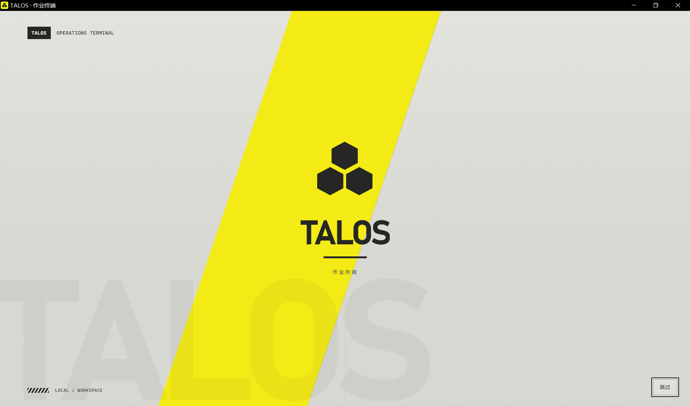
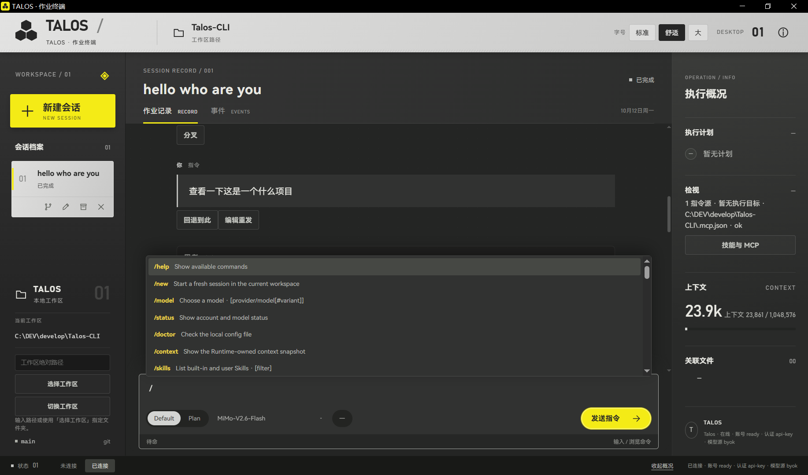

# TALOS Desktop

TALOS 的 Windows 作业终端。通过本机 `talos studio` 连接 Talos CLI，在桌面中使用同一套模型、工具、会话与权限。





## 安装与使用

当前版本 **0.1.2 / Windows x64**，已由用户验收。公开安装包仍待完成字体再分发核对；下载以 [GitHub Releases](https://github.com/PAKIKNOWLEDGE/T3rra-C0d3-Talos/releases) 实际可见资产为准。不要把源码压缩包当作安装程序。

1. 安装并配置 [Talos CLI](https://github.com/PAKIKNOWLEDGE/Talos-Code-CLI)，确保 `talos` 在 PATH 中可用、支持 Studio v2，并配置好 provider。
2. 安装桌面程序，打开 TALOS，选择实际项目文件夹。
3. 新建或打开会话，输入指令；输入 `/` 查看命令，使用 `@` 引用工作区文件。
4. 会话卡片提供分叉、重命名、归档和引擎支持的删除；执行中可停止，权限请求在界面确认。

安装包携带 Node 与桌面服务，不包含 CLI，也不会自动升级 CLI。已安装程序无需另开 npm/Vite 服务。首次无目录会显示「选择工作区」，有效目录会被记住。发送指令会按所选 provider 计费。

已知限制：流式思考暂不能展开、Markdown 一级/二级标题可能显示原始井号、部分工具调用记录完成后消失。详见 [待修问题](docs/issues.md)。Windows 本地候选未签名；截图是用户真实操作记录，不代表所有功能均已逐项验收。

## 本地开发

需要 Node `>=22.19 <23` 或 `>=24.2 <27`、npm；静态文档检查需要 Python。Windows 打包还需要 Rust/MSVC 构建环境与 WebView2。随包运行时固定 **Node v24.15.0 x64**，构建脚本校验官方 SHA-256。

```powershell
npm ci
npm run check:env
npm run dev:product -- --cwd "C:/path/to/workspace"
```

访问 http://127.0.0.1:5193/；后端观察端点为5194。在所属终端按 Ctrl+C 退出，不结束未知服务。只看产品壳可用 `npm run dev:shell`，没有引擎的壳不证明真实对话。静态视觉范本是 [demo/talos.html](demo/talos.html)。

## Windows 构建

```powershell
npm run build:desktop:win
npm run check:desktop:package
```

默认生成 NSIS：`src-tauri/target/release/bundle/nsis/TALOS_0.1.2_x64-setup.exe`。随包 Node、服务和资源须共同部署，不能单独复制 exe。

只构建 MSI，复用现有 Rust 缓存：

```powershell
npm run build:desktop:win -- --bundles msi
```

产物在 `src-tauri/target/release/bundle/msi/`。构建完成后复制到自己的目录；本轮没有构建或验证 MSI。以上命令不执行 `cargo clean`。首次 MSI 构建可能下载 WiX，不能用 NSIS 的验收代替 MSI 的安装验证。

可检查指定安装目录，并按需只握手/载入测试工作区，不发模型请求：

```powershell
node tools/check-desktop-package.mjs --installed-dir "C:/path/to/install" --workspace "C:/path/to/test-workspace"
```

图标已包含在源码中，无需每次生成；重新生成用 `npm run build:desktop:icons`，需要 Pillow。

## 检查

| 命令 | 范围 |
| --- | --- |
| `npm run typecheck` | spike 入口及导入链；不是全产品严格类型检查 |
| `npm run typecheck:desktop` | 生产桌面服务入口及导入链 |
| `npm run test:core` | 离线核心测试，包含 mock |
| `npm run check:demo` | 静态范本结构；不证明渲染 |
| `npm run check:handoff` | 文档链接、交接字段与 demo 基线 |
| `npm run check:all` | 类型、核心测试、demo、handoff 聚合 |

没有自动界面验收；真实画面由用户手动确认。仅文档修改运行 `npm run check:handoff` 与 `git diff --check` 即可。

## 资料与贡献

[当前状态](docs/status.md) · [路线与当前任务](docs/plan.md) · [协作方式](docs/workflow.md) · [代理规则](AGENTS.md) · [视觉边界](docs/design.md) · [Studio 接驳证据](docs/adapters/talos-engine.md)

桌面宿主管目录、子进程与显示；CLI 管模型、工具执行、持久数据和权限。保留 Studio 协议，不复制引擎业务，不使用 Electron。游戏参考图仅作本地设计参考，不进入安装包。

## 第三方资产

TALOS 使用 **HarmonyOS Sans SC** 字体。其 [官方许可副本](docs/licenses/HarmonyOS-Sans-LICENSE.txt) 及当前 WOFF2 来源缺项见 [资产记录](docs/licenses/README.md)。获取许可原文不等于当前字体已获再分发确认。

随包 Node 与 ws 的许可分别为 [Node](tools/runtime/NODE-LICENSE.txt)、[ws](tools/runtime/WS-LICENSE.txt)，安装资源携带这些声明。本仓未声明整体开源许可证；第三方许可不自动覆盖项目源码。
