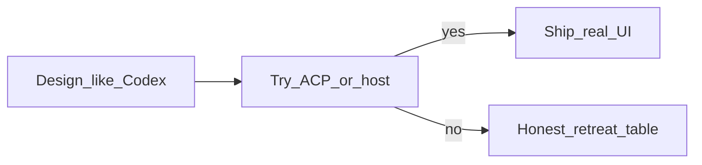

# Talos 桌面计划

本页是 **Talos Desktop 工作室** 的产品脊骨与实现带划分。引擎待办见 Talos-CLI [docs/status.md](https://github.com/PAKIKNOWLEDGE/Talos-Code-CLI/blob/main/docs/status.md)。执行入口见 [status](status.md)。

## 北星：工作室，对标 Codex / pi-desktop

Talos Desktop = 给本机 **Talos CLI** 配的 **工作室窗口**（Endfield 视觉，[design](design.md)、[demo/talos.html](../demo/talos.html)）。与 TUI **互补，不取代**；不是网页客服，也不是第二套 agent。

用户得到的是一间工作室：

| 区域 | 用户得到什么 |
| --- | --- |
| 左 | **活的目录**：这个项目里有哪些活；新建；点开继续；正在跑的能看出来 |
| 中 | **这一件活的记录**：对话、工具、停、斜杠、模式/模型 |
| 右 | **这一件活的后果**：改了哪些文件、待批准、用量；以后才是完整 diff 审查台 |
| 底 | **投料**：打字、`/`、以后 `@` 与附件 |
| 壳 | **真窗口**（Tauri 后置）；现在浏览器跑，不假装已是安装版 |

现状诚实句：能换项目、能调模式/模型、能发广告斜杠，但 **只有一条活**；侧栏「当前会话」是装饰，不是目录。

## 选型站规：先 Codex 设计，ACP 碰壁再撤

1. **设计时**按成熟桌面（Codex、Claude Code Desktop、pi-desktop 类）画交互与信息架构，不因「ACP 套壳」先画瘦。
2. **实现时**只经 `talos acp` 调引擎；ACP/引擎没有的，从本轮交付撤，写入 [认了](#认了acp-或引擎边界)，界面不装有。
3. **宿主可做**：起停子进程、布局、窗体、选文件夹、空态与错误文案（不冒充 Codex app-server）。
4. **禁止**：假按钮；未授权改 Talos-CLI 内核；把云端通宵、手机派活当近期承诺。

## 产品结构合同

| 工作室要给人 | 现在 | 实现带 |
| --- | --- | --- |
| 项目归属 | 能换 cwd | 已有 |
| 活的目录与回来 | 仅一条绑定 | **带 1** |
| 多件活并排 | 一条通道 | 带 1 先 **切换**；真并行受单连接约束，见探针 |
| 审查与信任 | 聊天里读字 + 批准卡片 | **带 2** |
| 投料 `@`/附件 | 打字 + `/` | **带 3** |
| 真窗口 | 浏览器 | **带 4** |
| 货架能力 | 无 | 设计记得，不承诺 |

旧 A–G（换目录、模式/模型、斜杠等）是已落地的 **控制面零件**，不是脊骨。thinking effort、permissionMode、`/provider`、假计划栏：仍不造假。

## 实现带

| 带 | 内容 | 状态 |
| --- | --- | --- |
| 0 | 文书：站规、脊骨、探针、带 1 设计 | **已完成**（2026-10-09） |
| 1 | 活的目录：列表 / 新建 / 点开 load | **列/开/新建已过**；缺退役，桌面暂停（2026-10-09） |
| 2 | 审查台与批准记忆 | 未开始 |
| 3 | 投料（`@`/附件） | 未开始 |
| 4 | Tauri 2 外壳 | 未开始 |

## 带 1 设计：活的目录

对标 Codex 侧栏 **按项目的线程列表**（不是 demo 里假会话样张）。贴 [demo/talos.html](../demo/talos.html) 左侧栏布局与 Endfield 色，替换 `#sessionList` / `#currentSessionBadge` 的 static 语义。

### 用户动作与结果

| 动作 | 用户应看到 | 引擎/宿主行为（设计） |
| --- | --- | --- |
| 打开 / 换工作区 | 侧栏列出 **该 cwd** 下的历史活（标题或时间）；当前项高亮 | `session/list` + `cwd`；分页用 `nextCursor` |
| 点一条活 | 中间记录切到该会话；可继续发指令 | `session/load` + 更新 `.talos/gui-session.json` |
| 新建活 | 新一行出现在列表；中间空记录或欢迎态 | `session/new`；绑定新 `sessionId` |
| 正在跑 | 当前活有运行态（与顶栏 phase 一致） | 沿用现有 `turn` 快照；列表项显示「运行中」 |
| 列表空 | 文案 +「新建第一个活」 | 不伪造历史 |
| 引擎未连 | 侧栏说明未连接，不假装有列表 | 诚实空态 |

### 不做（带 1 范围外）

- 会话内 fork 树（ACP 有 fork，产品另开）
- 真并行两路 prompt（见探针：单 client 连接）
- 归档 UI（list 可含 archived，首版可只显示不过滤）
- Tauri 选文件夹（带 4）

### 落地文件（授权编码时）

- [app/index.html](../app/index.html)、[app/talos.js](../app/talos.js)、[app/ui-manifest.json](../app/ui-manifest.json)
- [src/adapter/minimax-acp.ts](../src/adapter/minimax-acp.ts)、[src/service/talos-service.ts](../src/service/talos-service.ts)、[src/core/types.ts](../src/core/types.ts)、[src/service/workspace-session.ts](../src/service/workspace-session.ts)
- 机读：`test/` 增加 list/load 与 snapshot 合并用例；`npm run typecheck` + `test:core`

## ACP 边界探针（带 1，【源码】Talos-CLI）

相邻引擎 `C:\DEV\develop\Talos-CLI`，路径相对该根。桌面带 1 已接 `session/list`（绑定/切换/新建后刷新）。

| 能力 | 引擎事实 | Desktop 今天 | 带 1 结论 |
| --- | --- | --- | --- |
| `initialize` → `loadSession` | `agent.ts` ~442 `loadSession: true` | 已用 | 继续 |
| `sessionCapabilities.list` | `agent.ts` ~452–456 | 未用 | **接 list**，不撤目录 |
| `session/list` | `agent.ts` ~625–638，`runtime.listSessionPage` | 未接 | **带 1 必接** |
| `session/new` | 已有 | 换工作区时隐式 new | 显式「新建活」 |
| `session/load` | 已有；回放经 `session/update` | 仅绑定一条 | 点列表项 load |
| `session/fork` | 已实现，能力广告 `fork: {}` | 无 | **带 1 不做**；登记带 2+ |
| `promptCapabilities` image/embed | initialize 均为 false | 无附件 | **带 3** 再探，现撤 |
| 单 ACP 连接 | `agent.ts` ~357–360 每进程仅一 client | 单 WS | **多件活 = 切换附着**，非双 prompt 并行 |
| 活跃 prompt 互斥 | `agent.ts` ~1068 拒绝并发普通 prompt | 单 turn | UI 不承诺双活同时跑 |

证据摘录见 [talos-engine 工作室带 1 探针](adapters/talos-engine.md#工作室带-1-acp-探针2026-10-09)。

## 认了（ACP 或引擎边界）

| 项 | 状态 | 用户看到什么 |
| --- | --- | --- |
| Prompt 图片/嵌入上下文 | 引擎 `promptCapabilities` 全 false | 带 3 前无拖图/嵌入；不假装有 |
| 会话 fork 树 | 协议/产品未做 | 无 fork 菜单 |
| 双会话同时跑 | 单连接 + 单活跃 prompt | 可切换会话，不能两路同时生成 |
| Codex 式 app-server / 云端 thread | 非 Talos 架构 | 无 `/app`、无云同步；CLI 与 Desktop 各连 `talos acp` |
| 统一 diff 审查台 | 无宿主 diff RPC | 带 2 前只有路径列表 + 详情弹窗，不称「审查台」 |
| 云端通宵 / 手机派活 | 未承诺 | 无相关入口 |

## 带 2–4（同一站规，另授权）

| 带 | 对标 Codex 什么 | 先设计再接线；碰壁写入上表 |
| --- | --- | --- |
| 2 | 侧栏 diff、行评、stage/commit、批准 remember | 工具 update + `request_permission` 已有；diff 台与记忆规则待核 |
| 3 | `@` 自动完成、附件 | 依赖 `promptCapabilities` / 引擎；现全 false |
| 4 | 安装包、系统选文件夹、通知 | Tauri 2；不改引擎 |

## 两仓串行与漏项门禁

主人 2026-10-09：CLI 是 mcode fork、独立 npm，迭代必须走 **CLI 自己的流**，不可与桌面并行赶同一能力。桌面清不掉会话，是 ACP 门面没开删除，不是桌面忘了画按钮。

**不是三线全崩。** 上游 mcode 只读参考；Talos-CLI 一条引擎线；本仓一条 GUI 线。缺删除 = 引擎 ACP 未广告 `session/delete`（协议 schema 有，fork 未开门）。TUI `/archive` 也不清桌面列表（`list` 含 archived）。

### 漏这个漏那个怎么办

根因不是「没对照 Codex」，而是把 **退役** 当成货架功能。parity 写了「钉/归档/改名不做」，等于允许做出「能新建的活目录」却没有退出。

门禁（带 2 起，带 1 补退役时也遵守）：侧栏每露出一种引擎对象，计划里必须写 **列 / 开 / 建 / 退役** 四格；ACP 没有退役就 **先停**，记「CLI 开门」或「界面诚实不能删」，禁止中途加假按钮、禁止借漏项开下一带。

发现漏项：冻本仓功能 → 一张欠账（哪条 ACP、CLI 有无内部能力）→ 若必须有，**下一张卡只在 CLI 仓**。不在桌面补洞、不并行改两仓。

### 现在怎么走（串行）

1. **本仓停功能。** 总线（工作室脊骨）仍有效；带 1 未闭合的是退役，不是推翻带 1。带 2–4 不开。
2. **要清列表：只开工 CLI。** 读 Talos-CLI `docs/status.md`，按它的方案/闸/发布做 `session/delete`（或等价、且 list 不再把已删/归档塞给桌面）。这是 fork 相对上游的切割点，**在 CLI 线完成**，不是桌面线。
3. **CLI 发布进 PATH 的 `talos` 之后**，本仓再开「侧栏删除」小轮，只接已发布 ACP，不跟 CLI 源码并行。
4. 日常维护：GUI 只读本仓 status；动引擎只读 CLI status；跨能力时两张卡都写「谁阻塞谁」，同时只允许 **一个仓在执行**。

## 引擎侧

Provider 仍走 TUI `/provider` 或 CLI。本仓不改 Talos-CLI，除非主人在 **引擎仓** 按 CLI 流另开任务（不与本仓并行）。

## Codex 对标与第一期预期（Astra 收紧）

主人 2026-10-09 接受 [parity](desktop-codex-parity.md) 7 条。Astra **不加项**：fork、thinking、并行、diff、终端、附件一律不进本轮。

## 下一小轮：活的目录（带 1）

| 项 | 内容 |
| --- | --- |
| 标识 | `talos-desktop-studio-nav` / r1 |
| 角色 | **Astra**：收计划（本段写完即停）→ **Luna**：实现与机读 |
| 目标 | [parity 第一期 7 条](desktop-codex-parity.md#第一期就这些7-条给-astra-收) |
| 不做 | 并行双跑、worktree/云、diff 台、终端、MCP 页、附件、fork、Tauri、归档钉住、计划栏造真、thinking 下拉 |
| Luna 停止点 | `npm run typecheck` + `npm run test:core` 绿；`ui-manifest` 登记新建/列表；status 写完成证据；主人 7 条目视 |

### Astra r1 交付（到此为止，不写代码）

主人已接受 parity **7 条**为第一期唯一用户结果；本带只服务「活的目录」，不借历史会话扩成客服单窗或货架功能。

**协议事实（实现不得越界）**：`session/list` + `session/new` + `session/load`（回放）；单 ACP 连接、单活跃 prompt；`load` 失败须**留在当前条**（parity 表）；列表失败须可见错误、不伪造历史。

**Luna 执行切片（顺序建议，可同轮合并自验）**

| 切片 | 交付物 | 对应 7 条 |
| --- | --- | --- |
| S1 快照与动作 | `sessions` / `sessionListError` 进 WS 快照；`new_session` / `load_session`；跑 turn 时 service 拒切 | 5、7 |
| S2 工作区生命周期 | 绑定后 `list`；`switch_workspace` 清列表并再 list | 1、6 |
| S3 侧栏产品 | `#newSession` + `#sessionList` 贴 demo 布局；wired 非 static；运行中禁用切活/新建 | 1–4、5 |
| S4 诚实失败 | `action_error` toast；list/load/new 错误文案 | 7 |
| S5 机读 | `session-index` / fact-store / service 用例；`EnginePort` 测试桩补齐；`test:core` 纳入新文件 | Luna 停止点 |

**Astra 明确不授权本轮**：`session/fork`、`session/resume` 作主路径、并行双 prompt、diff 台、Tauri 选夹、附件、`thinking` UI。

工作树若已有 WIP 实现片段，Luna 以本切片验收为准整理，不以「已写一半」扩范围。

## Git

文档与 `app/` 在本仓；引擎只在 Talos-CLI。
